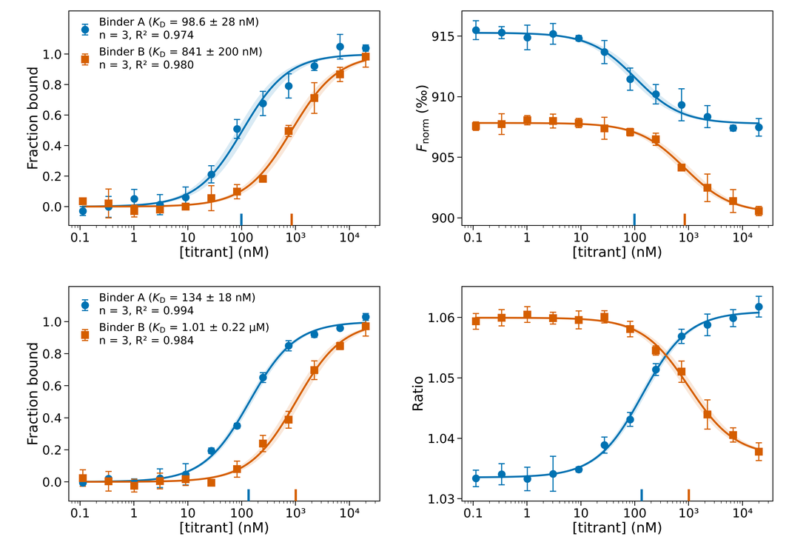

# Dianthus binding analysis

Fits NanoTemper Dianthus titrations — TRIC (Fnorm) and spectral shift (670/650 ratio) — and makes publication-ready figures, result tables, PowerPoint decks and a methods paragraph.

- **1:1 binding with ligand depletion** (Morrison quadratic), repeats fitted globally (shared KD, own baselines), 95% CI by residual bootstrap
- **Two-site model** (two independent classes of site) as an alternative reported model
- **Diagnostics on every sample**: ΔAICc against a linear non-specific term, a Hill fit and a two-site fit; Hill EC50 and nH saved
- **Optional Hill figure set**, including the linearised Hill plot
- **Reads** wide Excel/CSV sheets and the Dianthus software's own export tables; TRIC vs ratio detected automatically
- **Figure rows** sized to a page width (default 180 mm) with identical data boxes — place at 100% and fonts are the sizes you set

*`Figure_rows` from the bundled example data: TRIC row (top), spectral-shift row (bottom).*

## Quick start
1. Click **Open in Colab** above.
2. Edit the **settings** cell (at minimum `TOTAL_TARGET_NM`, `TITRANT_NAME`, `TRACER_DESCRIPTION`).
3. **Runtime → Run all**, then upload your file(s) when asked. A zip of all outputs downloads at the end.

To try it first, upload the files in [`examples/`](examples/): `example_wide_tric.xlsx` + `example_wide_ratio.xlsx` together (1:1), or the four files in `examples/export_tables/` with `FIT_MODEL = "two_site"`. All example data are synthetic.

## Inputs (both kinds can go in one run)
| Layout | What it looks like | How repeats are grouped |
|---|---|---|
| **Wide sheet** | Row 1 = sample names, one per column pair; columns alternate conc. (nM) / signal. A header row under the names is optional. | Column pairs with the same name |
| **Dianthus export table** | The instrument's own table (`Well ID`, `Ligand Conc.`, `Ligand Conc. Unit`, `Ratio` or Fnorm, `Anomaly`) — one file per repeat | File name minus `table-` and trailing `-<number>`s: `table-K11-EL17-3.xlsx` → `K11-EL17`. All export files of one readout are pooled. |

TRIC vs ratio is detected from the signal size, so files don't need naming.

## Settings you will actually change
| Setting | Use |
|---|---|
| `TOTAL_TARGET_NM` | Total tracer in the well (labelled + unlabelled), nM |
| `FIT_MODEL` | `"1:1"` (default) or `"two_site"`. Decide before looking at the data. |
| `TWO_SITE_KD2_NM` | Fix the weak-site Kd (nM) when the top concentration can't define it, e.g. from an independent experiment. `None` = fitted. |
| `MAX_CONC_NM` | Ignore wells above this concentration (all samples; state it as a rule). `None` = use all. |
| `DROP_ANOMALIES` | Export tables only: drop wells the instrument flagged in `Anomaly`. Default `False`. |
| `HILL_FIGURES` | `True` = also write a `hill/` folder: panels, grid and overlays with the Hill fit (EC50 ± CI, n_H) and the classic linearised Hill plot (log[θ/(1−θ)] vs log[L]; slope = n_H, zero crossing = EC50). Hill panels, overlay and Hill plot are appended to the main PPTX after the reported-model slides. Descriptive only; roughly doubles run time. |
| `X_SCI_FROM` | x-axis labels plain below this (nM), 10ⁿ from it. Default 1000 → 0.1 1 10 100 10³ 10⁴. |

## Main figure: `Figure_rows.pdf` / `.svg` / `.png`
One row per readout (TRIC row, then spectral-shift row), two panels per row: fraction bound with the legend ("K11 (K_D = 187 ± 50 nM)" / "n = 5, R² = 0.99"), then the raw signal. It is exactly `PAGE_WIDTH_MM` wide (default 180 mm, an A4 page with margins) and every data box is identical, so **place it at 100%** and the fonts are the sizes set in AESTHETICS. With `HILL_FIGURES = True` there is a matching `Figure_rows_hill`. `Figure_rows.pptx` holds both at true size on A4 slides. The two panels also exist as separate files in each readout folder (`overlay_panel`, `overlay_raw`), same box size.

## Changing figure text
All text on the figures lives in the **LABELS** block of the settings cell: sample display names (`SAMPLE_LABELS`), axis labels, the Kd / EC50 / n_H symbols, the representative-panel title, panel titles on/off, and whether legends show n and R².

## Reading `results.csv`
- `Kd_nM`, `Kd_CI95_low/high`: the reported model (Kd1 for two-site), with residual-bootstrap 95% CI.
- Two-site extras: `Kd2_nM` (+CI if fitted), `frac_tight_site` = fraction of the signal change from the tight site.
- Diagnostics, always run: `dAICc_1to1`, `dAICc_nonspecific`, `dAICc_hill`, `dAICc_twosite` = AICc(reported) − AICc(alternative). **Positive = the alternative fits better; > 6 = strongly.** Also `hill_EC50_nM`, `hill_n` (Dianthus-software-style Hill; with `HILL_FIGURES` also their 95% CIs), and `twosite_Kd1_nM`, `twosite_Kd2_nM`, `twosite_frac_tight`.
- Flags worth acting on: `two-site strongly favoured` (consider `FIT_MODEL = "two_site"` *for the next experiment's pre-specified analysis*), `two-site not resolved by these data` (Kd2 ran beyond the data — fix `TWO_SITE_KD2_NM` or stay with 1:1), `Kd2 near/above top concentration`.

## Outputs
| File | Content |
|---|---|
| `Figure_rows.pdf/svg/png` | Main figure: one row per readout, fraction bound (with legend) + raw signal |
| `Figure_rows_hill.*` | Same, Hill fits (`HILL_FIGURES = True`) |
| `Figure_rows.pptx` | The above at true size on A4 slides |
| `<readout>/results.csv` | All numbers, flags and diagnostics per sample |
| `<readout>/methods.txt` | Auto-generated methods paragraph, including the notebook version |
| `<readout>/<sample>.*`, `all_samples.*` | Per-sample panels (fit, CI band, residuals) |
| `<readout>/overlay_panel.*`, `overlay_raw.*` | The two row panels as separate files |
| `<readout>/Figure_TRIC.pptx` / `Figure_SpectralShift.pptx` | Per-sample panel grids + overlays (+ Hill section) |
| `<readout>/hill/` | Hill figure set, incl. the linearised Hill plot |

## Citing a fixed version
`main` always holds the latest notebook. For a paper, cite the tagged version printed at the top of each run and in `methods.txt`, e.g.
`https://github.com/eoinleen/dianthus-analysis/tree/v33` — and the Colab link to exactly that version is
`https://colab.research.google.com/github/eoinleen/dianthus-analysis/blob/v33/Dianthus_analysis.ipynb`.

## Updating the notebook (maintainer notes)
The file name never changes; Git keeps the history. From Colab:
1. Make the change; bump `NOTEBOOK_VERSION` at the top of the analysis cell (e.g. `"v34"`).
2. **Edit → Clear all outputs** (outputs contain your data and figures, and this repo is public).
3. **File → Save a copy in GitHub** → repository `eoinleen/dianthus-analysis`, branch `main`, file path `Dianthus_analysis.ipynb`, a one-line commit message.
4. Add a line to `CHANGELOG.md` (edit it on github.com: pencil icon).
5. On github.com: **Releases → Draft a new release** → tag `v34` → Publish. That creates the fixed version others can cite.

## Licence
MIT — see [LICENSE](LICENSE).
